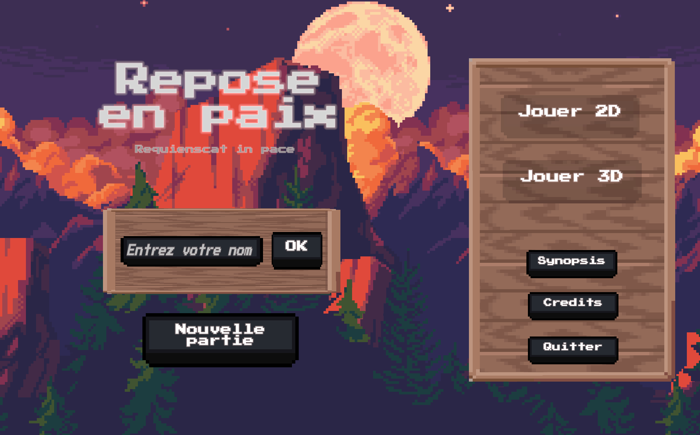
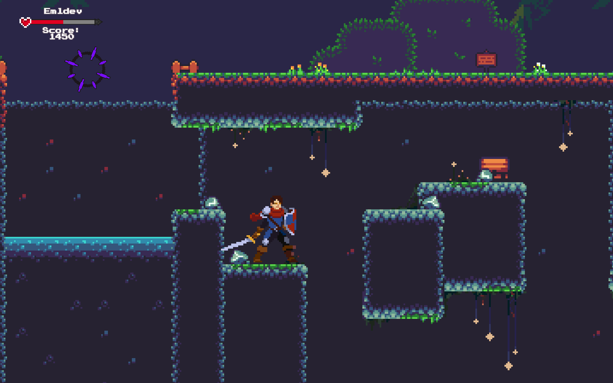
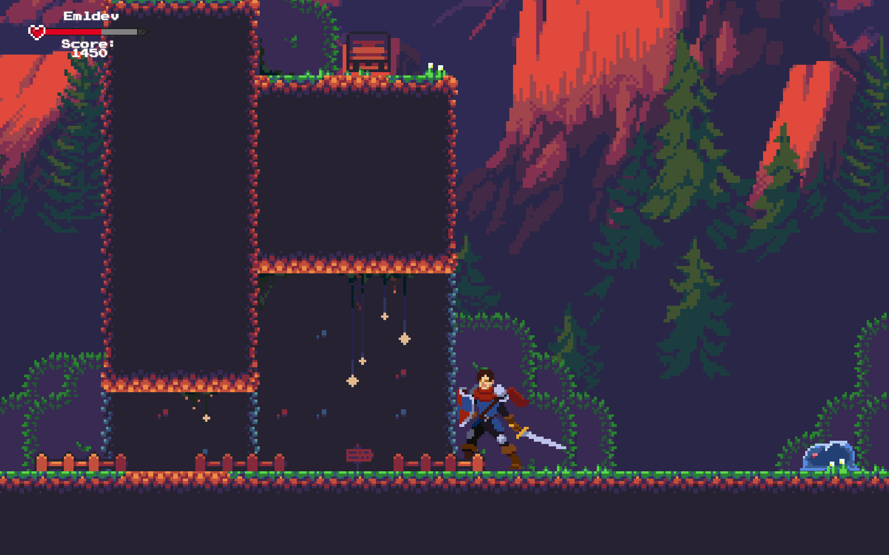
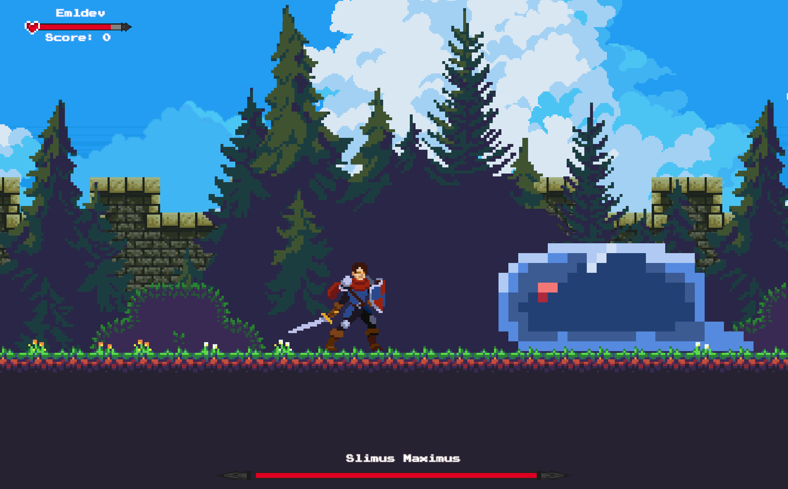
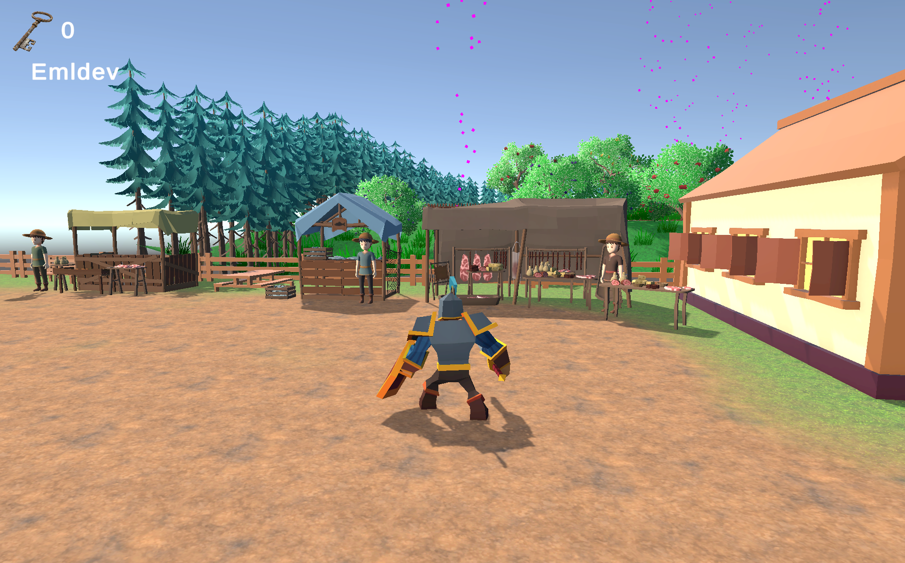

[Français](README.md) | [English](README.en.md)

# Village

*RIP: Rest in Peace*

A Unity game project: a dead adventurer comes back as a skeleton in the dungeon where he died, years after the fact. Driven by the hope of finding his family again, he escapes the dungeon and heads back to his old village, now largely turned into a graveyard, to learn what became of his family and pay his respects.

The full game is split in two parts: a 2D stretch through the dungeon in the style of a Metroidvania/Souls-like, then a low-poly 3D exploration of the village and graveyard, with dialogue, side quests, and puzzles. This repo holds the C# scripts for both parts.

> **Note on this repo:** this is a trimmed-down version of the full Unity project. It only contains the original C# scripts, not the scenes, the licensed art/animation/audio assets, or the project configuration files. Because of that, the project won't open as-is in Unity; this repo is meant to show the code, not to provide a playable build.

## Tech

- Unity 6000.0.36f1 (Unity 6)
- Universal Render Pipeline (URP)
- Cinemachine, Unity Input System, AI Navigation (NavMesh), Timeline, Visual Scripting
- TextMeshPro for dialogue and UI

## Gameplay systems

- **Movement and camera:** third-person character controller (`CharacterController`) with jumping, gravity, and rotation toward the movement direction; switches between Cinemachine cinematic cameras and a first-person view with Tab, with mouse look and adjustable angle limits in FPS mode.
- **Interaction:** nearby interactables are found with a collision sphere check and triggered with the E key; chat bubbles turn to face the camera and destroy themselves after a few seconds; the available action (talk, open a door, and so on) is shown contextually.
- **NPCs and dialogue:** NPCs patrol between points on the NavMesh and stop to talk once the player enters their sight range; dialogue text types out letter by letter and can be sped up or advanced with a click; some NPCs change what they say depending on what the player is carrying.
- **Inventory and quests:** keys and flowers are picked up from the world; keys open doors that swing around a hinge and get consumed on use; a flower quest unlocks a crypt once enough flowers are gathered or placed in the right spot; a flower can also be offered at a grave to pay respects.
- **Enemies and combat:** a generic enemy AI patrols, chases, and attacks based on distance and line of sight to the player; a chicken that stays harmless until provoked, then turns aggressive and charges the player after being hit five times; a boss fight triggered by a zone, with its own health UI and a score reward on death; vertically oscillating damage zones in the 2D section.
- **Progression and score:** a temporary scene score is added to the player's total once the scene is cleared; some passages require a minimum score to continue, and warn the player if they fall short; levels unlock progressively and the save persists between sessions.
- **Menus and player identity:** a name has to be entered before the main menu buttons become usable; a HUD keeps showing the player's name and current score; a reset button clears the save entirely (name, score, unlocked levels).
- **Audio:** a single audio manager swaps the music depending on the zone the player is in; dedicated sounds play for opening or finding a locked door, and for picking up items.
- **Ending:** reaching the family's grave plays a specific sound and fires a global win event; a zone-based variant shows a victory UI and pauses the game.

## Screenshots

Playable build: [ben11178.itch.io/rip](https://ben11178.itch.io/rip)

|  |  |
|:---:|:---:|
| *Title screen, with the choice between the 2D and 3D parts* | *A spike trap to get past* |
|  |  |
| *Making it across the dungeon's platforms* | *Fighting the boss "Slimus Maximus" in the dungeon* |
|  | |
| *The village market, in 3D* | |
